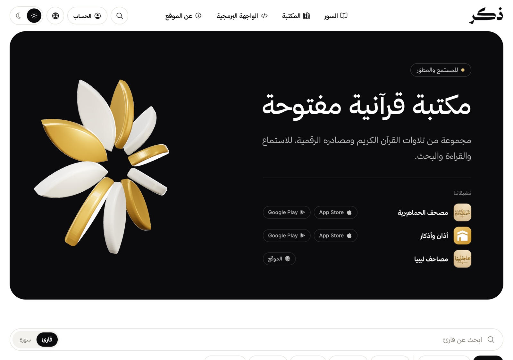
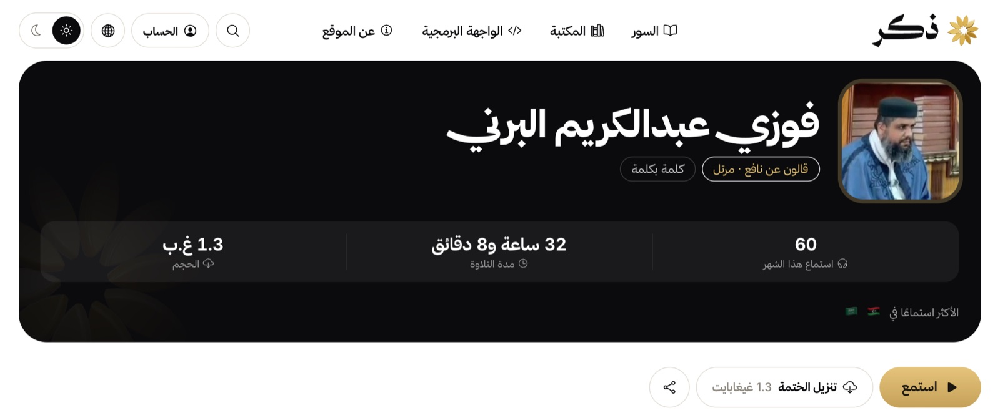
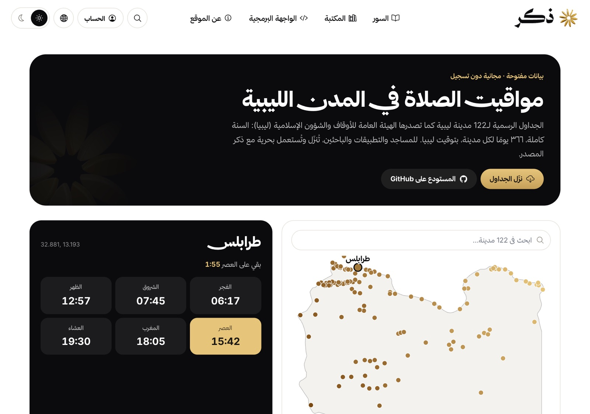
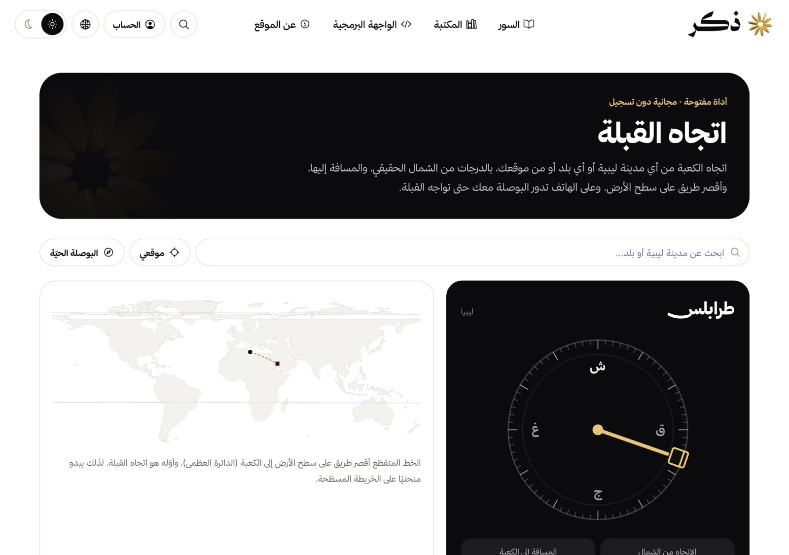
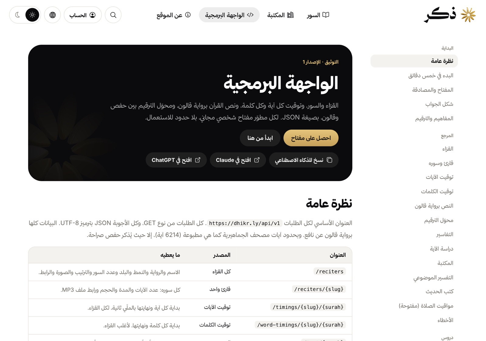
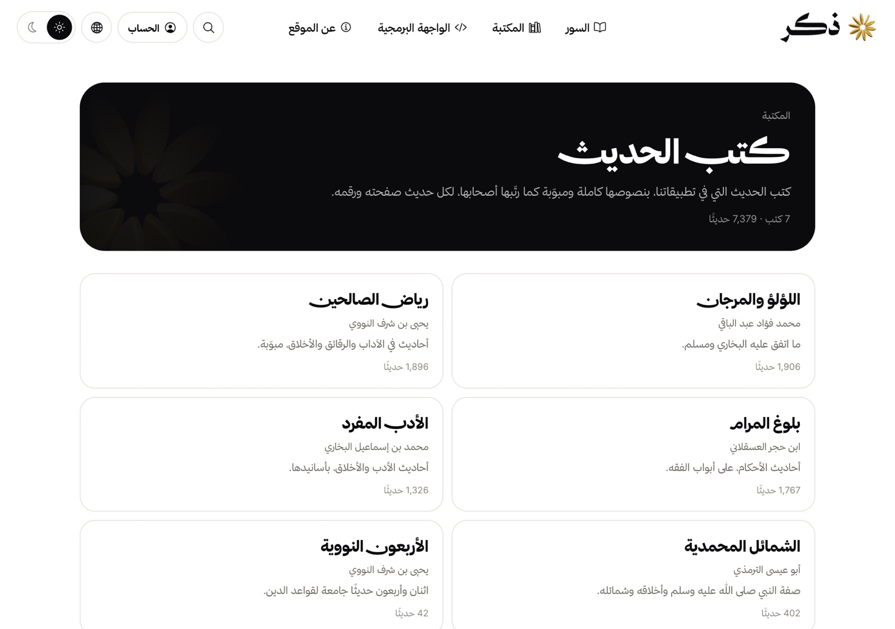

<p align="center">
  <a href="https://dhikr.ly">
    
  </a>
</p>

<h1 align="center">ذكر · Dhikr</h1>

<p align="center">
  An open Quran library: recitations in the riwaya of Qalun timed word by word, the Libyan prayer times, tafsir, hadith and books, with a free API.
</p>

<p align="center">
  <a href="https://dhikr.ly"></a>
  <a href="https://dhikr.ly/developers"></a>
  <a href="#languages"></a>
  <a href="#contributing"></a>
</p>

<div dir="rtl">

## بالعربية

ذكر موقع مفتوح يجمع تلاوات القرآن الكريم برواية قالون عن نافع ونص المصحف والتفاسير والحديث والكتب ومواقيت الصلاة في مكان واحد، ومعه واجهة برمجية مجانية. وهو مصدر البيانات نفسه الذي تقوم عليه تطبيقاتنا: أذان وأذكار، ومصحف الجماهيرية، ومصاحف ليبيا.

- **إحداثيات الكلمة:** 38 تلاوة، منها أكثر من 30 لقرّاء ليبيين، كل تلاوة موقّتة كلمةً كلمة، فتضيء الكلمة لحظة نطق القارئ بها.
- **مواقيت الصلاة الليبية:** الجداول الرسمية لـ122 مدينة، وهي المواقيت نفسها في تطبيق مؤذن ليبيا وساعات توقيت في المساجد، مع طرق الحساب لسائر البلدان.
- **نص القرآن برواية قالون** آيةً آيةً مع الجزء والحزب والثمن، ومحوّل لترقيم الآيات بين حفص وقالون.
- **تسعة تفاسير** مربوطة بآيات قالون، و**سبعة كتب** من الحديث، ومكتبة في التجويد والرسم والضبط، والموسوعة القرآنية.

المشروع مفتوح لكل من أراد أن يسهم فيه، مبرمجًا كان أو غير مبرمج: تصحيح توقيت كلمة أو اسم قارئ، أو اقتراح تلاوة، أو ترجمة، أو إصلاح في الكود. انظر [المساهمة](#contributing).

</div>

## Screenshots

<table>
  <tr>
    <td width="50%"><p align="center"><b>Home</b>: the open library and our apps</p></td>
    <td width="50%"><p align="center"><b>A reciter</b>: Qalun, word by word, the whole khatma to stream or download</p></td>
  </tr>
  <tr>
    <td width="50%"><p align="center"><b>Prayer times</b>: the official tables for 122 Libyan cities</p></td>
    <td width="50%"><p align="center"><b>Qibla</b>: from any city, with a live compass on phones</p></td>
  </tr>
  <tr>
    <td width="50%"><p align="center"><b>The API</b>: documented in Arabic and English, ready for AI assistants</p></td>
    <td width="50%"><p align="center"><b>Hadith</b>: seven collections, 7,379 hadiths</p></td>
  </tr>
</table>

## Features

- **Word-by-word recitations.** 38 recitations in Qalun, more than 30 of them by Libyan reciters. Every recitation is timed ayah by ayah and word by word, so the recited word lights up as it is heard. More reciters are added as they are prepared.
- **Libyan prayer times.** The official tables for 122 Libyan cities, the same times as the Muadhin Libya app and the Tawqit mosque clocks, open to download as CSV, JSON and SQLite. Elsewhere, the known calculation methods for every country.
- **The Qalun text.** Ayah by ayah (6,214 ayahs, Madinan count), with juz, hizb and thumun, and a converter between Hafs and Qalun numbering.
- **Tafsir and study.** Nine complete tafsirs mapped onto the Qalun ayahs, a study page for every ayah (word meanings, occasions of revelation, rhetoric, rulings), and the thematic tafsir encyclopedia.
- **Hadith and books.** Seven hadith collections and a library of books on tajwid, orthography and ayah counting.
- **One search** across the Quran, tafsir, hadith and books.
- **Qibla** from any place, with the great-circle path on a map and a live compass on phones.
- **Whole khatmas to download**, and the site installs as an app on any phone or computer (PWA, offline listening).
- <a id="languages"></a>**12 languages:** Arabic, English, French, Spanish, German, Turkish, Indonesian, Malay, Urdu, Persian, Bengali and Russian.

## The API

Base URL `https://dhikr.ly/api/v1`. JSON over GET, free, with a personal key from [dhikr.ly/account](https://dhikr.ly/account). Prayer times and qibla need no key. Full documentation: [dhikr.ly/developers](https://dhikr.ly/developers) (also as Markdown for AI assistants at [dhikr.ly/developers.md](https://dhikr.ly/developers.md)).

| Endpoint                                                     | Gives                                                        |
| ------------------------------------------------------------ | ------------------------------------------------------------ |
| `/reciters`, `/reciters/{slug}`                              | Every recitation, and one recitation's surahs with MP3 links |
| `/timings/{slug}/{surah}`                                    | When each ayah starts and ends                               |
| `/word-timings/{slug}/{surah}`                               | When each word starts and ends                               |
| `/text/{surah}`                                              | The Qalun text, ayah by ayah, with juz, hizb and thumun      |
| `/numbering/{hafs\|qalun}/{surah}/{ayah}`                    | An ayah's number in the other count                          |
| `/tafsir/{id}/{surah}`, `/ayah/{surah}/{ayah}`               | Tafsir by Qalun ayah, and the study of one ayah              |
| `/hadith`, `/library`, `/mawsuah`                            | Hadith collections, books and the encyclopedia               |
| `/prayer-times/libya/{city}`, `/prayer-times/calc`, `/qibla` | Prayer times and qibla (open, no key)                        |

```sh
curl https://dhikr.ly/api/v1/word-timings/fawzi_albarni/1 \
  -H "Authorization: Bearer $DHIKR_KEY"
```

## Run it locally

Requirements: Node.js 20.9 or newer, and Yarn 4 through Corepack.

```sh
corepack enable
yarn install
cp .env.example .env.local
yarn dev
```

The site runs with no other setup: the reciters, word timings, qibla, prayer methods and API documentation work out of the box. Some parts need more, and `.env.example` explains each setting:

- **Accounts and the keyed API** need Postgres (`DATABASE_URL`, then `node scripts/migrate.mjs`).
- **The Libyan prayer tables** are read from a folder (`PRAYER_ROOT`, default `.content/prayer`) holding the data of [libya-prayer-times](https://github.com/Jawad18750/libya-prayer-times).
- **Library, hadith, tafsir and the encyclopedia** read the apps' content from disk (`CONTENT_ROOT`, `QURANPEDIA_ROOT`).
- **The printed mushaf pictures** come from a separate service that is not part of this repository. Without it their places stay empty.

Checks before a pull request:

```sh
yarn tsc --noEmit
yarn lint
yarn test
yarn build
```

## Project layout

| Path             | What is there                                                                                                               |
| ---------------- | --------------------------------------------------------------------------------------------------------------------------- |
| `src/app`        | Routes: the Arabic site at the root, the other languages under `/{locale}`, and the API under `src/app/api`                 |
| `src/components` | Pages and site components                                                                                                   |
| `src/lib`        | Server logic: API, search, prayer times, tafsir, accounts, SEO (`src/lib/seo/routes.ts` is the source of every public path) |
| `src/locales`    | The 12 language files                                                                                                       |
| `src/data`       | The Qalun text, the numbering tables and other bundled data                                                                 |
| `db/migrations`  | Postgres schema, applied by `scripts/migrate.mjs`                                                                           |
| `scripts`        | Content sync, search index, SEO audit                                                                                       |

## Contributing

Everyone is welcome: programmers and non-programmers alike.

- **Corrections:** a word timed wrong, a reciter's name or photo, a translation that reads badly. Open an issue with the page link and what is wrong.
- **Reciters:** suggest a recitation in Qalun (or another riwaya) with where it can be found.
- **Code:** pick an issue labelled `good first issue`, or open one to discuss an idea first.
- **Using the data:** build on the API in your own site or app, and tell us about it.

How to send a change (people and AI assistants alike):

1. Branch from `tilawat` (the default branch), for example `fix/word-timing-2-255`.
2. Never push to `tilawat` and never merge: open a pull request into `tilawat` and wait for review.
3. Keep the change to what the issue needs. No new dependencies without asking first.
4. Never commit `.env` files, keys or anything secret.

See [CONTRIBUTING.md](CONTRIBUTING.md) for details.

## Licence

- **Code:** MIT, see [LICENSE](LICENSE).
- **Data served by the API:** [CC BY-NC 4.0](https://creativecommons.org/licenses/by-nc/4.0/): free for non-commercial use, with attribution to «ذكر · dhikr.ly».
- **Third-party texts** (tafsirs, hadith collections, books, the Quranic encyclopedia) remain their authors' and publishers', credited on each page.
